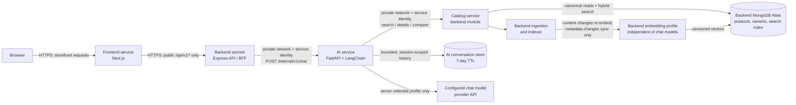
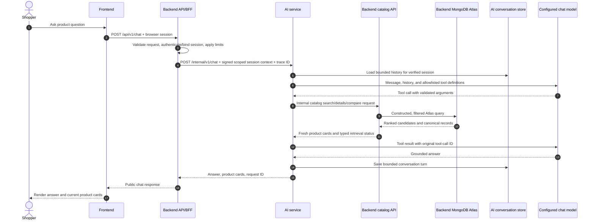

# Forma service architecture

The storefront frontend, Node.js backend, and Python AI service are independently deployed services. The browser has one trusted API entry point: the backend. The backend owns customer-facing auth/session controls and the canonical catalog; AI is a private orchestration service, not a second public backend.

## Service and data ownership

| Service | Owns | Does not own |
|---|---|---|
| Frontend (Next.js) | Storefront UI and transient presentation state | Provider credentials, catalog truth, model selection |
| Backend (Express) | Public API/BFF, caller auth/session, rate limits, product/variant data, Atlas search/indexes, catalog API | LLM prompts, model orchestration, conversation reasoning |
| AI (FastAPI) | Chat orchestration, model profiles, validated tools, bounded conversation history and evaluation | Product writes, canonical catalog, direct access to backend MongoDB |

The backend's MongoDB/Atlas deployment is the source of truth for products, variants, stock, price, and derived catalog search data. The AI service has a separate, least-privilege conversation store with a seven-day TTL. There is no shared database access between backend and AI.

## Service graph

## Chat request sequence

## Contracts and trust boundaries

- The frontend calls only the backend's public, versioned API. It never calls AI or a model provider directly and never selects a production model profile.
- The backend verifies the browser's identity/session and enforces public request limits before calling AI. It sends a short-lived, audience-restricted signed context containing only the opaque conversation/session binding and necessary authorization claims.
- Backend-to-AI and AI-to-backend calls use private networking plus workload identity or mTLS. Do not rely on an untrusted forwarded browser header as service authentication.
- AI tools call narrow backend catalog APIs; they never receive MongoDB credentials or construct raw database queries. The backend validates every filter and returns current product/variant facts.
- The AI conversation store is separate from the catalog store. Conversation records are keyed by the verified session binding, bounded, and TTL-expired.
- Product descriptions and model/tool outputs are untrusted data. AI tool schemas reject extra fields; backend catalog APIs independently validate their inputs.
- Propagate request/trace IDs and a shared absolute deadline. Return typed errors for invalid input, unavailable catalog, provider timeout, and no results; never turn dependency failure into an empty catalog result.

## Latency, reliability, and scaling

The extra backend→AI→backend hop is an intentional boundary cost for catalog security and ownership. Keep it bounded and predictable:

- Reuse async HTTP clients and keep-alive connections for internal calls; use service discovery rather than hard-coded production addresses.
- Have one catalog search operation return complete, fresh matching variant cards. Avoid an N+1 product-details call per result.
- Keep the chat tool loop capped (four rounds/eight executions), pass the request deadline through each hop, and reserve time for the final model response.
- Run backend and AI independently with horizontal scaling. Scale AI on concurrent model calls and backend on catalog/API load; keep both services stateless apart from their owned databases.
- Use separate per-service limits, circuit breaking/short timeouts, redacted structured telemetry, and graceful degradation. A catalog outage must produce a clear unavailable response, not invented products.

This deliberately favors service ownership and credential isolation over direct AI-to-catalog-database access. If measured latency later requires it, first optimize the internal API and search indexes; consider a separately owned, asynchronously refreshed AI read model only with explicit staleness and reconciliation guarantees.

## Local development addresses

| Service | Local address | Intended access |
|---|---|---|
| Frontend | `http://localhost:3000` | Browser |
| Backend | `http://localhost:4000` | Frontend and local service calls |
| AI | `http://127.0.0.1:8000` | Backend in deployed environments; direct local access only for development/diagnostics |
